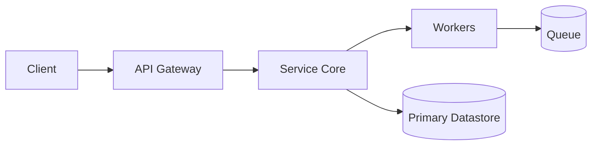
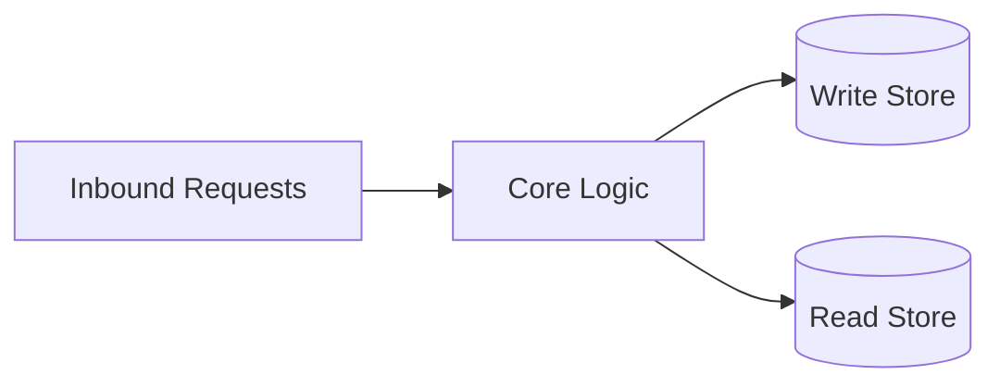
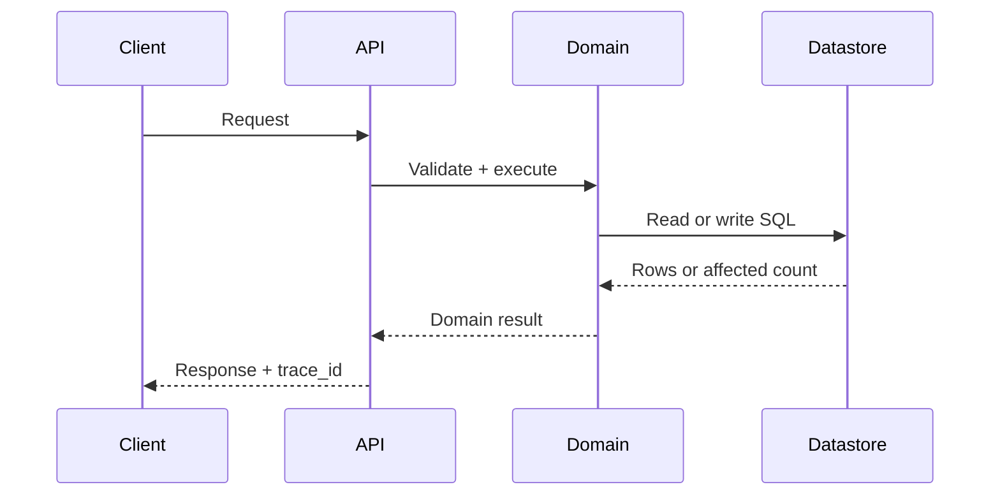
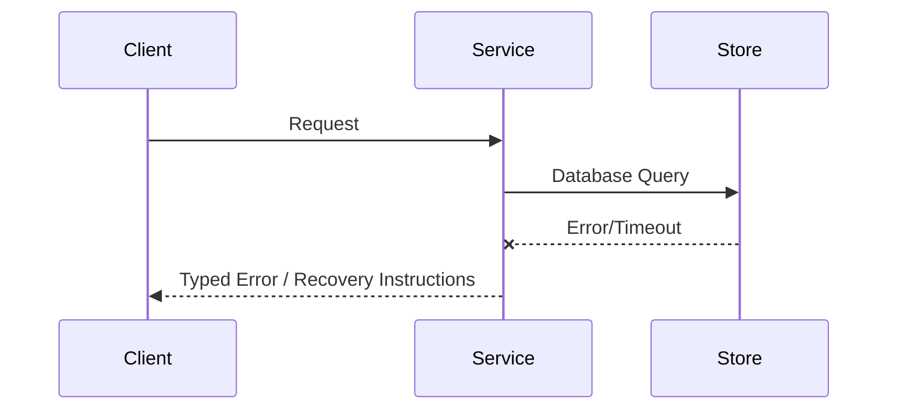

# Architecture

## FIFO mixed sync/async transport pool limits, cancellation handoff, and baseline (issue #144)

- **`src/http_pool.rs` (`RequestLimit`, `LimitState`, `WaiterGuard`, `SharedHttpClient`)**: Replaces unordered `Condvar` + `Notify::notify_waiters()` signaling with a FIFO `VecDeque<WaiterEntry>` waiter queue (`WaiterWake::Sync(Arc<(Mutex<bool>, Condvar)>)` and `WaiterWake::Async(Arc<tokio::sync::Notify>)`). Contended callers enqueue in arrival order (`state.waiters.is_empty()` prevents hot-caller barging), `RequestSlot::drop` transfers slot ownership directly to the oldest ungranted waiter without thundering-herd wakeups, and `WaiterGuard::drop` removes cancelled/timed-out waiters and forwards any already-granted slot to the next waiter when an async future is dropped between handoff and next poll.
- **`src/adapter/neon/mod.rs` & `src/cloud.rs` (pre-send deadline boundary)**: `send_neon_request` and `send_neon_request_async` obtain `blocking_client()` / `async_client()` prior to computing `deadline` and acquiring `_permit` (matching `src/adapter/supabase.rs`), and `neon/mod.rs` plus `send_auth_once` / `send_auth_once_async` (`src/cloud.rs`) return `MutationOutcome::NotAttempted` (`EffectStatus::NotAttempted`, `ObservationSource::LocalPreflight` on cloud channels) when `deadline` expires before `request.send()`.
- **Baseline & policy boundary (`docs/transport-load-baseline.md`, `tests/transport_load_fairness_144.rs`)**: Measures queue vs. service time, `p50`/`p95`/`p99`, active/idle sockets, cross-platform open FDs/RSS, and aggregate `64`-slot / `64`-pool bounds across sustained and faulted burst workloads without introducing tenant admission scheduling in Dactyl.

## Cross-layer transport fault reconciliation and origin cutover resilience (issues #143, #138)

- **`src/http_pool.rs`, `src/adapter/supabase.rs`, & `src/cloud.rs` (`#143`, `#138`)**:
  - `with_dpop_nonce_retry` and `with_dpop_nonce_retry_async` (`src/http_pool.rs`) gate single-retry `401` `use_dpop_nonce` challenges on `can_retry_dpop_nonce`, refusing to retry whenever `MutationOutcome::Uncertain` or `EffectStatus::{Uncertain, CommittedObserved}` provenance is already present.
  - Non-2xx mutating responses in `handle_supabase_response` (`src/adapter/supabase.rs`) and `handle_cloud_response` (`src/cloud.rs`) propagate `mark_remote_uncertain` / `post_send_error` whenever provenance attests `EffectStatus::Uncertain` (including `401`/`409`/`429` `accepted_not_committed` responses outside `408`/`5xx`), and `is_missing_onboarding_function` refuses `404` legacy fallback if `MutationOutcome::Uncertain` was observed.
  - `handle_supabase_response` (`rpc && ctx.validate_rows` failure paths), `decode_write_response`, and `decode_atomic_response` record `EffectProvenance::transport_fault` (`EffectStatus::Uncertain`) on mutating decode/budget failures when server provenance was unadvertised, and `cloud.rs` preserves same-origin `Decapod-Cloud-Request-Id` on `fault_metadata` and post-header malformed-response fault paths (`http_pool::provenance_fault` preserves it when `origin_bound`).
  - Pre-send pool saturation/client initialization/worker-spawn errors in `src/http_pool.rs`, `src/adapter/supabase.rs` (`prefix_local_preflight`), and `src/cloud.rs` emit `"local preflight: ..."` messages so `DactylError::mutation_outcome()` returns `MutationOutcome::NotAttempted` consistently with `ObservationSource::LocalPreflight`.
  - `tests/transport_fault_reconciliation_143.rs` runs an instrumented SQLite-backed loopback HTTP fault proxy and 12-seed x 24-step campaign proving zero duplicate commits, zero false rollback/committed classifications, zero unauthorized commits under mid-flight policy revocation, and `#138` origin cutover resilience across `goyxpcmxetztjlrrcwew.supabase.co` <-> `api.decapodlabs.ai`.

## Differential contract verification and wire compatibility hardening (issues #145, #146)

- **`src/rows.rs` & `src/adapter/sqlite/mod.rs` (`#145`, `#146`)**: `Parameter::deserialize` (`visit_u64`) uses `i64::try_from` to fail closed on out-of-range unsigned integers (`> i64::MAX`) instead of silently wrapping. `SqliteAdapter` validates finite `Parameter::Real` values in `check_parameters` preflight before statement preparation or transaction start, verifies `sqlite3_stmt_readonly` in `visit_rows_budgeted` so `read`, `visit_rows`, and `WITH ... INSERT` read-batch operations cannot mutate durable state, and emits `GeneratedKey::Integer` in `execute_write` only when `affected_rows > 0`.
- **Differential & skew proof surfaces**: `tests/differential_contract.rs` pairs `ReferenceModel`, `SqliteAdapter`, and an independent SQLite-backed HTTP `dactyl_api` RPC/gateway/legacy server with `shrink_counterexample` delta-debugging and independent read-only observer readbacks. `docs/wire-compatibility-matrix.md` and `tests/wire_compatibility.rs` (with recorded JSON fixtures in `tests/fixtures/wire_compat/`) verify additive-vs-breaking skew, version floors, downgrade refusal, unknown enum refusal, stale-origin discovery refusal, and `https://api.decapodlabs.ai` DPoP `htu` parity across sync and async connectors.

## Staged first-party custom origin cutover (issue #138)

- **`src/connector.rs`, `src/cloud.rs`, & `src/lib.rs` (`#138`)**: `DEFAULT_CLOUD_ORIGIN` remains `"https://goyxpcmxetztjlrrcwew.supabase.co"` while `FIRST_PARTY_CLOUD_ORIGIN` (`"https://api.decapodlabs.ai"`), `FIRST_PARTY_AUTH_PATH` (`"/auth"`), and `FIRST_PARTY_REPO_PATH_PREFIX` (`"/decapod"`) provide explicit opt-in staging primitives via `LogicalTarget::first_party_cloud()`, `LogicalConnector::first_party_cloud()` / `first_party_cloud_async()`, and origin-bound `canonical_auth_url()` / `canonical_repository_url(org, repo)`. `validate_canonical_path_segment` rejects empty, oversized (`>128`), traversal (`.`, `..`), slash, query, fragment, percent-encoded, and whitespace inputs before constructing `/decapod/<org>/<repo>`. Existing discovery origin-matching (`profile.project_origin == selected_origin`), no-redirect HTTP policies, `validate_start` `/functions/v1/{decapod,propodus}-onboarding/begin` path enforcement, and DPoP `htu` canonical URL signing remain strictly bound to the selected origin.

## Runtime-aware HTTP pool budgets, per-operation effect provenance, and onboarding/admin auth enforcement (issues #134, #140)

- **`src/budget.rs` & `src/http_pool.rs` (`#134`)**: `SharedHttpClient` pools are keyed by `PoolSettings::from(ResourceBudget)` (`connect_timeout`, `http_max_in_flight`, `http_max_idle_per_host`, `http_idle_timeout`), gated by both per-budget `RequestLimit` (`Condvar` + `tokio::sync::Notify`) and a `64`-slot process ceiling (`MAX_PROCESS_IN_FLIGHT`), with lazy `blocking_client()` and per-`tokio::runtime::Id` `async_clients` (bounded to `16` runtimes per pool). `in_tokio_runtime()` avoids spawning helper threads for synchronous callers outside Tokio, while native `*_async` execution paths in `src/cloud.rs`, `src/adapter/neon/mod.rs`, `src/adapter/supabase.rs`, and `src/lib.rs` run directly on the active Tokio runtime without blocking worker handoffs (`read_bounded_body_async`, `with_dpop_nonce_retry_async`).
- **`src/connector.rs`, `src/http_pool.rs`, `src/cloud.rs`, `src/adapter/supabase.rs`, `src/lib.rs` (`#140`)**: `build_attempt_headers` attaches `Idempotency-Key`, `Decapod-Cloud-Attempt-Id`, `Decapod-Cloud-Provenance-Version: 1`, `Decapod-Cloud-Request-Digest` (SHA-256 of outbound request payload when omitted by direct writes, or explicit caller digest on readback), `Decapod-Cloud-Operation-Kind`, and optional `Decapod-Cloud-Scope-Ref`. `bind_response_provenance` merges `Decapod-Cloud-*` HTTP headers with parsed JSON `provenance` envelopes, enforces `response_url.origin() == expected_origin.origin()` (rejecting redirects `300..400`), auth scheme parity, operation kind, attempt ID, digest parity (`idempotency_conflict` on readback digest mismatch / `provenance_digest_mismatch` on direct mismatch), and caller scope ref, downgrades truncated/partial or malformed `2xx` bodies to `EffectStatus::Uncertain` (`ObservationSource::TransportFault`) even if headers claim `committed_observed`, preserves explicit non-commit server proofs (`NotAttempted`, `Refused`, `RolledBack`) on errors, and emits `UnsupportedProvenance` when servers do not advertise contract v1.
- **`src/cloud.rs`, `src/connector.rs`, & `src/error.rs` (human-Bearer preflight & admin actions)**: `AccountOperation` maps `RepositoryEnroll`, `ResourceLimits`, `OrgAdmins`, `OrgRecovery`, `PolicyTemplates`, and `OrgUpgrades` under `/functions/v1/decapod-onboarding/<action>` (with missing-function `404` fallback to `propodus-onboarding`). `CloudConnector::account_auth_policy` routes all human-required operations as `Bearer`-only under `.with_device_gateway()` (`RequestAuthPolicy::human_bearer()`), while `prepare_cloud_request` (`record_preflight`) enforces `require_human_bearer` before dispatch (rejecting `dpc_at_` device tokens and empty/malformed credentials) and normalizes local preflight adapter rejections (`"local preflight: ..."`) so `DactylError::mutation_outcome()` consistently returns `MutationOutcome::NotAttempted` alongside `EffectStatus::NotAttempted`.

## Wave 2 gateway auth policy, bounded nonce retry, runtime selector, and error classification (issues #132, #133, #136, #137, #138, #139)

- `src/lib.rs` defines `Backend::datastore(self) -> Datastore` and `Datastore::as_str(self) -> &'static str`, grounding `DatastoreRoute::sqlite` and `DatastoreRoute::supabase_rpc` in the logical backend without consulting ambient `DATASTORE`.
- `src/http_pool.rs` centralizes RFC 9449 challenge detection (`has_dpop_nonce_challenge`), bounded single-retry execution (`with_dpop_nonce_retry`), strict single-value `DPoP-Nonce` extraction (`validate_dpop_nonce` also rejects `"` and `\`), and `Retry-After` header capture alongside existing `DPoP-Nonce`, `Sunset`, `Deprecation`, and `Decapod-Cloud-*` metadata. Both normal `DPoP <token>` headers and managed `Bearer <user-jwt>` + `DPoP <proof>` (`managed_bearer_proof = true`) flows reuse this single helper without duplicating retry state machines.
- `src/cloud.rs` and `src/connector.rs` add `.with_device_gateway()` / `.uses_device_gateway()` propagating through `LogicalConnector`, `CloudConnector`, `CloudConnector::route`, and `SupabaseRpcConfig`. When `device_gateway` is enabled, `CloudConnector::account_auth_policy` routes account/billing/`DeviceChallenge`/`DeviceKeys`/`DeviceSessions`/`DeviceStepUp` with `Bearer`-only auth, enforces `Bearer` + `DPoP` on `DeviceEnroll`/`DeviceSession` (retrying `use_dpop_nonce` while keeping `Bearer`), requires `DPoP` on `DeviceRefresh`, allows caller-selected `Bearer` or `DPoP` on `DeviceRevoke`, and falls back from `decapod-onboarding/cloud-control` to `propodus-onboarding/cloud-control` only on missing-function `404` (`None | Some("not_found")`).
- `src/adapter/supabase.rs` routes `device_gateway` data calls to `/functions/v1/decapod-onboarding/cloud-query` and `/cloud-batch` using flat `VersionedRequest` bodies and control calls to `{gateway_prefix}/cloud-control` using `{"version":1,"function":...,"request":...}`, requires `dpop_header.is_some()` preflight (`device_proof_required`, `MutationOutcome::NotAttempted` via `src/error.rs`), and executes requests inside `with_dpop_nonce_retry`.
- Error mapping in both `src/cloud.rs` and `src/adapter/supabase.rs` preserves HTTP `429` `quota_exceeded`/`overage_cap_exhausted` as `AdapterErrorKind::Quota`, maps `provider_disabled`/`mfa_step_up_required`/`repo_access_denied` to `Authorization` and `device_key_expired`/`refresh_reuse_detected` to `Authentication`, and maps `project_not_found`/`member_not_found`/`invitation_not_found`/`flow_not_found` (`NotFound`) so domain `404`s never trigger legacy function fallback.

## Bounded HTTP connection pool and DPoP signing pipeline

`src/http_pool.rs` provides a weak-cached, Tokio-safe `SharedHttpClient` (`reqwest::blocking::Client` with `pool_max_idle_per_host(32)`, `pool_idle_timeout(15s)`, `redirect::Policy::none()`, `retry::never()`, and a plain-thread `Drop` joiner so dropping inside Tokio runtimes never panics and zero daemon threads survive client drop) alongside a bounded 32-slot `RequestPermit` concurrency gate enforcing `ResourceBudget` `request_timeout` deadlines. Both `src/adapter/supabase.rs` and `src/cloud.rs` canonicalize target URLs (stripping query and fragment), compute RFC 9449 `ath` (`URL_SAFE_NO_PAD(Sha256(token))`), invoke `RequestProofSigner::sign_request` synchronously prior to dispatch, attach `Authorization: DPoP <token>` + `DPoP: <proof>` (or `Bearer` compatibility), capture bounded `DPoP-Nonce`, `Sunset`, `Deprecation`, and `Decapod-Cloud-*` headers into redacted `CloudResponseMetadata`, and notify `RequestProofSigner::observe_nonce` on any valid `DPoP-Nonce` response header.

## Resource budget and streaming execution boundary (issue 101)

`src/budget.rs` centralizes `ResourceBudget` (`v1`), bounded JSON request serialization (`BoundedVecWriter`), chunked HTTP response reading (`read_bounded_body` without trusting `Content-Length`), recursive JSON nesting guards (`MAX_JSON_DEPTH = 64`), and `DecodedResultTracker` (charging column metadata, row overhead, and `32x` BLOB `serde_json::Value::Array` expansion with checked `u64` arithmetic before `Row` materialization). `src/adapter/sqlite/mod.rs` enforces preflight and pre-allocation result charges, implements `visit_rows_budgeted` with deterministic native `Statement` finalization on early stop or error, and answers `has_table` / `has_column` in one bound SQLite catalog query. `src/adapter/sqlite/recovery.rs` wraps staging table copies in one `BEGIN IMMEDIATE` ... `COMMIT` transaction and reuses a single prepared `INSERT` per table (`sqlite3_reset` + `sqlite3_clear_bindings`) via direct C-ABI column binds. `src/adapter/neon/mod.rs` and `src/adapter/supabase.rs` run bounded blocking HTTP on dedicated named worker threads (`dactyl-neon-http`, `dactyl-supabase-http`) safe inside Tokio runtimes, reject catalog predicates locally without network I/O, and mark post-send mutating failures as `MutationOutcome::Uncertain`.

## HTTP dependency compatibility boundary

The Neon, Supabase and managed-auth implementations retain their existing
reqwest blocking transport and bounded execution. An optional constraint under
`target.'cfg(any())'` requires patched quinn-proto during Cargo resolution but
never compiles or activates HTTP/3. The obsolete quinn-udp compatibility cap is
removed. Other active HTTP/IDNA/TLS bounds remain unchanged. Patched Quinn's
Rand manifests use Edition 2024, so the complete dependency-resolution contract
now requires Cargo/Rust 1.85 even for consumers that do not use HTTP/3.

## Snapshot inspection boundary

`src/inspection.rs` exposes limits and a callback-scoped reader without changing
the owned row API. `src/adapter/sqlite/inspection.rs` owns one read transaction,
scoped native progress/length limits, incremental row decoding and cleanup on
all exits. Decapod interprets records and computes domain inventory; Dactyl
does not adopt its schema, migrate data or collect semantic evidence.

## Logical connector and authentication boundary

`src/connector.rs` defines the unconditional per-workspace `LogicalTarget`,
`LogicalConnector`, and portable redacted session/account types so local and
cloud workspaces can be resolved, isolated, and opened side-by-side without
process-global caches, ambient environment variables, or downstream
`#[cfg(feature = "supabase")]` branching. Local `LogicalConnector` handles open
SQLite routes and fail closed with `Capability`
(`cloud_connector_required`) if cloud auth/account methods are
called. `src/cloud.rs` resolves a public versioned deployment profile from a
trusted origin and builds the existing native `SupabaseRpcConfig`. Failed cloud
discovery or disabled `supabase` compilation never falls back to local SQLite.
Discovery carries no user credential and cannot redirect the selected origin.
Managed Auth and onboarding requests use fixed same-origin paths through Dactyl;
application callbacks/browser interaction and private session persistence remain
caller-owned. The hosted runtime is Supabase Auth, PostgreSQL/RPC and deployed
functions, provisioned by Propodus IaC. No additional Propodus task server is
required.

The separate account channel accepts an `AccountOperation` (`Register`,
`Status`, `Quote`, `Checkout`, `Manage`, `Portal`), an opaque JSON body, the
current Supabase bearer and optional explicit `ScmCredential`. Fixed provider
and host metadata accompany only that linking credential. A managed sign-in
provider token may be Google and is never inferred to be an SCM credential.
Untrusted connector HTTP responses enforce bounded JSON nesting
(`MAX_JSON_DEPTH = 64`), map HTTP `409` to `Conflict`, and extract allowlisted
public error codes across Propodus (`error.code`), Supabase GoTrue v2
(`error_code`), and OAuth2 (`error`). All connector HTTP disables redirects and
retries; post-send failures or oversized responses on mutating/one-time calls
attach `outcome_unknown` so callers preserve pending checkpoints instead of
replaying ambiguous mutations.

## Secure shared-directory SQLite recovery

SQLite recovery is isolated in adapter/sqlite/recovery.rs. It creates a 0700 child directory and 0600 rebuild/journal, uses PERSIST during rebuilding and DELETE for final activation, preserves supported mode/owner/group, and uses atomic no-replace moves with inode checks. Both affected directories are synced. Rollback retains private diagnostics and never recursively cleans unknown entries.

## Direction
library

## What This Project Is
dactyl-db is a small Rust application driver: one normalized operation surface over a real local SQLite file and Vercel Neon. It is not a database-administration layer and does not reimplement SQLite.

The one maintenance exception is a narrow, explicit local-storage contract:
Dactyl can verify a SQLite file, make an online-backup snapshot, and perform a
quiesced logical dump/reload replacement. These operations remain physical
storage primitives; callers own repair policy, operator authorization,
migration meaning, and when to invoke them.

Architectural principles:
- **Simplicity**: Keep components focused and reusable.
- **Modularity**: Clearly defined interface boundaries and dependency separation.
- **Reliability**: Graceful failure handling and thorough verification.
- **Backend-neutrality**: local and Neon adapters receive the same SQL, parameters, operation kinds, opaque atomic batches, and optional caller-owned context; backend-specific handles remain private.
- **Context separation**: the physical `DatastoreRoute` remains distinct from the versioned opaque `StorageContext`. Local storage ignores cloud-only payloads, while Neon forwards the validated envelope without interpreting its fields.

## Current Facts
- Runtime/languages: Rust
- Detected surfaces/framework hints: to be confirmed
- Product type: to be confirmed

## Architecture Map
This project's architecture consists of the following key layers/directories:
- `src/`: Main source directory containing primary logic.
- `tests/`: Integration and unit test suite.

## Data Flows
- The application supplies SQL, bound values, and caller-owned schema operations.
- Dactyl selects the local or Neon adapter and enforces the operation/access boundary.
- For Neon, Dactyl validates the context envelope, attaches it to `/query` and
  `/batch`, and fails closed before transport when it is absent or malformed.
- The adapter returns normalized rows, explicit write results, typed errors, or an ordered atomic result.
- A local maintenance call uses the same private SQLite connection seam: live
  backup uses SQLite's online-backup API, verification uses full
  `integrity_check`, and recovery builds a validated sibling before atomic
  activation. Neon reports typed capability errors for local maintenance.

## Strongest Existing Primitives
- Define the strongest existing primitives in the codebase (e.g., helper utilities, base controllers, data access layers).

## Topology

## Store Boundaries

## Happy Path Sequence

## Error Path

## Execution Path
- Ingress parse + validation:
- Policy/interlock checks:
- Core execution + persistence:
- Verification and artifact emission:

## Concurrency and Runtime Model
- Execution model: each free `read` / `write` call constructs a short-lived adapter for the ambient route and drops it on return; explicit `Connection` scopes several application operations to one route.
- Isolation boundaries: Dactyl keeps no process-global cache and exposes no backend handle. Each local connection owns a private mutex-protected SQLite handle; SQLite's pager, lock, journal, busy timeout, and transaction machinery provide file isolation. `Connection::atomic` commits only after every operation succeeds.
- Backpressure strategy: owned by the backend or Neon service; Dactyl does not retry or schedule work.
- Shared state synchronization: each local handle is mutex-protected; a
  process-local path registry rejects recovery while another Dactyl handle is
  open, and recovery also uses SQLite's bounded exclusive transaction. Dactyl
  does not claim cross-process protection for idle handles, arbitrary external
  writers, or unreliable mounted filesystems.

## Deployment Topology
- Runtime units: none (library).
- Region/zone model: n/a.
- Rollout strategy: library releases via release-plz.
- Rollback trigger and blast-radius scope: callers pin a dactyl version; breaking changes are recorded in CHANGELOG.md.

## Data and Contracts
- Inbound contracts (application calls): `read`, `write_result`, `atomic`, `OpenOptions`, `StorageContext`, and owned row/result values.
- Outbound dependencies (datastores/queues/external APIs): optional runtime-loaded host SQLite and Neon/Propodus HTTP transport. The local C-ABI loader is isolated behind the private adapter module; no SQLite wrapper or bundled SQLite implementation is compiled into consumers.
- Data ownership boundaries: callers own schema definitions and migration policy; Decapod owns context meaning; Propodus owns cloud authorization; Dactyl executes only the documented caller-supplied schema subset and physical atomicity.
- Schema evolution + migration policy: outside Dactyl's scope.

### Issue #77 Direct SQLite Proof Boundary
- The local connector opens the caller-selected SQLite file through Dactyl's private runtime-loaded C ABI. `DACTYL_SQLITE_LIBRARY` is an explicit escape hatch for hosts whose shared-library name is not in the platform defaults; the crate does not bundle SQLite or expose the backend handle.
- The release proof must exercise an actual host SQLite runtime, verify the backend-neutral contract and existing-file compatibility, and keep the loader dependency-free from `rusqlite` and `libsqlite3-sys`. Neon/Vercel deployment parity and Decapod adoption remain cross-repository work owned by Propodus and Decapod.

## ADR Register
| ADR | Title | Status | Rationale | Date |
|---|---|---|---|---|
| ADR-001 | Ambient-env routing contract (DATASTORE/DATASTORE_ROUTE/DATASTORE_TOKEN) | Accepted | Single authoritative selector; no init(); per-call adapters for session isolation (dactyl #26) | 2026-08-01 |
| ADR-002 | Thin application API: read(sql, params) + write(sql, params) | Accepted | One uniform read/write surface for SQLite and Neon; administration remains outside the crate (dactyl #47) | 2026-08-01 |
| ADR-003 | Backend-neutral Adapter trait | Proposed | New backends (redis, mysql, cassandra) add one module + one DATASTORE arm; public surface unchanged | 2026-08-01 |
| ADR-004 | Pure-Rust local engine with opaque atomic batches | Superseded | The handwritten snapshot engine was removed when Issue #77 required existing SQLite file compatibility. Opaque batches remain part of the public contract, but SQLite owns execution and durability. | 2026-08-11 |
| ADR-005 | Opaque storage-context forwarding | Accepted | Keep physical route configuration and cloud tenancy separate: Dactyl validates only a versioned envelope, ignores it locally, forwards it to Neon, and leaves authorization semantics to Propodus (#64) | 2026-08-11 |
| ADR-006 | Local fixture completeness before live Propodus | Accepted | Issues #57 and #64 are complete for the local store and the offline Neon mock: CAS is a zero-row observation, concurrent writers share a file lock, cleanup is `DROP`, and live Vercel Neon/Propodus proof is a separate deployment issue | 2026-08-12 |
| ADR-007 | Dactyl-owned snapshot format, not a SQLite file header | Superseded | The snapshot and its sidecars were removed; the local route now opens the requested SQLite file directly. | 2026-08-12 |
| ADR-008 | Explicit pure-Rust SQLite-to-Dactyl import for issue #77 | Superseded | The revised Issue #77 scope requires direct compatibility, so the importer and custom reader were removed. | 2026-08-12 |
| ADR-009 | Real SQLite local connector for issue #77 | Accepted | Use the smallest suitable SQLite binding behind the private adapter, preserve the existing backend-neutral API, and leave schema/migration policy outside Dactyl. | 2026-08-13 |
| ADR-010 | Explicit SQLite maintenance through the existing adapter seam | Accepted | Add typed `verify_integrity`, online `backup`, and dump/reload recovery methods to `Connection`; validate and fsync temporary files before activation, preserve the original plus sidecars, require same-process quiescence, and always activate logical recovery in DELETE journal mode. | 2026-09-09 |

## Delivery Plan (first 3 slices)
- Slice 1 (ship first):
- Slice 2:
- Slice 3:

## Risks and Mitigations
| Risk | Likelihood | Impact | Mitigation |
|---|---|---|---|
| Contract drift across components | Medium | High | Spec + schema checks in CI |
| Runtime saturation under peak load | Medium | High | Capacity model + load tests |

<!-- decapod:capability-overlay:persistent-state:start -->

Generated capability obligations: `persistent-state` is declared for this project. These are decisions and proof requirements, not claims of implemented behavior. Resolve each against project source and tests; record unsupported or non-applicable mechanisms explicitly.

## Persistent State Architecture Overlay

### State Ownership
- Each entity type MUST have a designated state owner
- State ownership boundaries MUST be explicitly documented
- Cross-boundary state access MUST go through defined interfaces

### Transaction Boundaries
- Multi-entity mutation atomicity and partial-failure treatment MUST be documented and proven for the selected store
- Transaction boundaries MUST be documented in ARCHITECTURE.md
- Document compensation or other partial-failure treatment if distributed operations exist

### Storage Abstraction
- Storage ownership, consistency behavior, and access boundaries MUST be explicit
- Portability or swappable implementations are project decisions, not universal requirements
- Migration and rollback treatment MUST match the selected storage technology
<!-- decapod:capability-overlay:persistent-state:end -->

<!-- decapod:codebase-contract:start -->

## Codebase Contract Snapshot

- Core modules (12): `adapter`, `budget`, `cloud`, `connector`, `contract`, `error`, `http_pool`, `inspection`, `lib`, `rows`, `schema`, `supabase_rpc`
- Plugin/extension modules (0): none detected
- Build manifests (1): `Cargo.toml`
<!-- decapod:codebase-contract:end -->

<!-- decapod:codebase-attestation:start -->

## Codebase Attestation

- Repository signal fingerprint: `d48c9e1e1cd75ab5e3686715792172387e10225b2b045bd903caa1e115775a6f`
- Significant implementation surfaces: `.github/` (4 files), `Cargo.lock/` (1 files), `Cargo.toml/` (1 files), `README.md/` (1 files), `examples/` (1 files), `src/` (19 files), `tests/` (30 files), `tools/` (3 files)
- Refreshed from the current codebase by `decapod rpc --op specs.refresh`
<!-- decapod:codebase-attestation:end -->

## Supabase service adapter (issue 91)

The provider selector and transport are separate concepts: SQLite uses Local;
Neon and Supabase use Http. Supabase is an opt-in private adapter behind the same
Connection read/write/atomic facade. It requires HTTPS, explicit authentication,
and context before a request; has bounded network/body budgets; refuses redirects;
and never falls back to local storage. A service route is not a Supabase REST URL
or a PostgreSQL connection string. Physical transactions, PostgreSQL connection
modes and authorization are service implementation responsibilities and must be
proved separately from synthetic HTTP fixtures.

## Native read-only batch boundary

Native read-only batches select dactyl_read_batch_v1; the service marks read query/batch wrappers STABLE and PostgREST owns the physical transaction. Dactyl owns no PostgreSQL pool and never retries an unknown mutation outcome.

## Opaque control RPC seam (issue 123)

`LogicalConnector::control_request` delegates cloud calls through
`CloudConnector` to `adapter::supabase::control_request`. The native adapter
shares `rpc_headers` and the bounded HTTP worker with datastore query/batch
execution, bypassing datastore result-shape decoding only for opaque control
JSON. A fixed validated origin/schema and one identifier select the native
function; the request is one opaque JSON `request` argument. Managed bearer
validation occurs before dispatch. ResourceBudget bounds wire bytes and
deadlines; shared JSON depth, no-redirect/no-retry and redacted errors remain.
Explicit OperationKind governs acknowledgement uncertainty only, not server
permissions or transaction access mode. Mutations include audit writes and
return outcome_unknown plus MutationOutcome::Uncertain after ambiguous loss.
