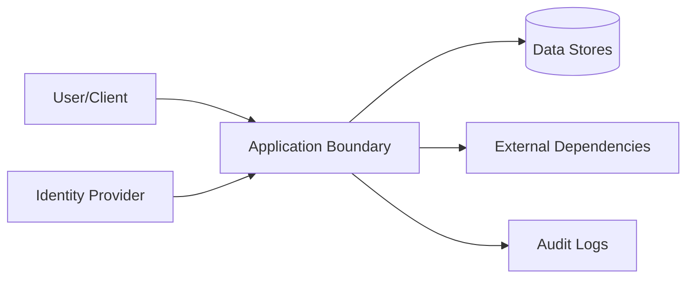

# Security

## Bounded resource envelopes and redacted remote transport (issue 101)

`src/budget.rs` enforces preflight bounds on SQL, `StorageContext`, bound parameters, batch length, and serialized JSON request bytes (`BoundedVecWriter`) before local statement preparation or network transmission, preventing oversized outbound buffers. Inbound Neon and Supabase HTTP bodies are read in fixed chunks (`read_bounded_body`) up to `max_wire_bytes + 1` without trusting peer `Content-Length` headers, checked against `MAX_JSON_DEPTH = 64`, and charged against `DecodedResultTracker` (including `32x` BLOB array amplification with checked `u64` arithmetic) before `Row` materialization. Both Neon and Supabase disable HTTP redirects and automatic retries, redact transport/server error text, reject `has_table` / `has_column` locally without issuing ad-hoc catalog SQL, and surface post-send mutating failures as `MutationOutcome::Uncertain` so callers do not treat ambiguous remote writes as rolled back.

## Patched inactive dependency graph

The manifest no longer constrains quinn-proto to the vulnerable pre-0.11.10
range. It requires >=0.11.19, covering the published RustSec Quinn remediation
without an advisory ignore or inactive-package exemption. HTTP/3 remains
disabled, so this is a resolution and consumer-audit correction rather than a
claim of observed runtime exposure. `tools/proof/check.py` verifies the floor in
both the repository and clean-consumer locks. These targeted guards do not
constitute a complete advisory audit. Rust/Cargo 1.85 replaces the old 1.75 floor
because the patched graph contains Edition 2024 manifests; no transport, token,
identity, authorization or secret-custody behavior changes.

## Diagnostic read boundary

Snapshot inspection accepts only SELECT/WITH and rechecks native statement
read-only status. It rejects preparation-time PRAGMA and enforces scoped native
and result budgets. Callers own authorization, redaction and bounded callback
work. No raw handle, credential, automatic maintenance or remote fallback is
exposed.

## Cloud connector and managed-auth credentials

`src/connector.rs` and `src/cloud.rs` keep credential-bearing types
(`AuthenticationSecrets`, `UserSession`, `ScmCredential`) private-custody-only
with redacted `Debug` implementations across every Cargo feature combination, and
never fall back to local SQLite when cloud profile discovery or `supabase`
feature compilation fails. `src/cloud.rs` discovers only public profile metadata
before sending credentials. The selected HTTPS origin is trusted configuration;
profile-origin mismatches, redirects, secret/service-role keys and invalid
schemas fail before native RPC construction. Literal loopback HTTP exists only
for disposable tests. Access bearers accompany data calls, account readiness
requests (`Register`, `Status`, `Quote`, `Checkout`, `Manage`, `Portal`), and
authenticated completion; refresh tokens and PKCE verifiers are sent only to
fixed managed Auth paths on that same origin. Dactyl stores no durable sessions
and does not open the browser. Untrusted HTTP JSON bodies enforce bounded 16 KiB
size and `MAX_JSON_DEPTH = 64` recursion limits, and post-send failures on
one-time exchange, rotation, revocation, or mutating account calls return
`outcome_unknown` so callers never replay ambiguous state transitions. Propodus-managed
Auth/RLS/grants enforce identity and permissions; caller context and local agent
labels cannot elevate cloud authority.

Normal account and data access depend on the Supabase user session, paid-seat
assignment and backend tenant/project isolation. Optional explicit SCM linking
adds X-SCM-Token, X-SCM-Provider and X-SCM-Host only to the account channel, with
fixed GitHub/GitLab hosts; it never supplies ordinary data authority. Dactyl does
not infer this channel from a sign-in provider token. Redirects and automatic
retries are disabled for auth, discovery and account requests. Only allowlisted
public Propodus, GoTrue (`error_code`), and OAuth2 (`error`) denial codes appear
in errors; remote messages and credentials do not.

## Secure shared-directory SQLite recovery

Private staging and creation-time modes protect rebuilt data under permissive umasks. Activation restores existing permission bits only after validation. Source access ACLs, inherited default ACLs and MAC/system access labels fail closed rather than being silently replaced; unrelated user attributes and unchanged parent POSIX access ACLs are permitted. Original/archive metadata remains untouched. Callers must quiesce filesystem name/content/metadata writers from connection open; inode checks are detection boundaries, not protection against arbitrary malicious concurrent directory writers.

## Threat Model

## STRIDE Table
| Threat | Surface | Mitigation | Verification |
|---|---|---|---|
| Spoofing | Auth boundary | strong auth + token validation | auth tests |
| Tampering | State mutation APIs | integrity checks + RBAC | integration tests |
| Repudiation | Critical actions | immutable audit logs | log review |
| Information disclosure | Data at rest/in transit | encryption + classification | security scans |
| Denial of service | Hot paths | rate limit + backpressure | load tests |
| Elevation of privilege | Admin interfaces | least privilege + policy checks | authz tests |
| Tampering / confusion | Local store path | open through SQLite's file validation; do not convert or reinterpret unknown files; fail closed on malformed databases | `existing_sqlite_fixture_opens_without_conversion` and typed invalid-database mapping |
| Destructive recovery / partial replacement | Explicit SQLite maintenance API | No automatic repair; require an unused same-directory archive, validate and sync a new file before activation, preserve main/WAL/SHM originals, and attempt rollback on rename/sync/reopen failure | `sqlite_maintenance` recovery, archive-conflict, and reopen contract tests |
| Concurrent store access | SQLite maintenance and mounted filesystems | Live backup uses SQLite's online backup API; recovery requires same-process quiescence and cooperating writers; arbitrary external writers and unreliable advisory-lock propagation remain unsupported | WAL backup, open-connection, and bounded lock tests plus documented limitations |

## Authentication
- Identity source:
- Token/session lifetime:
- Rotation and revocation:

## Authorization
- Role model:
- Resource-level policy:
- Privilege escalation controls:

## Data Classification
| Data Class | Examples | Storage Rules | Access Rules |
|---|---|---|---|
| Public | docs, non-sensitive metadata | standard | unrestricted |
| Internal | operational telemetry | controlled | team access |
| Sensitive | tokens, PII, secrets | encrypted | least privilege |

## Sensitive Data Handling
- Encryption at rest:
- Encryption in transit:
- Redaction in logs:
- Retention + deletion policy:

## Supply Chain Security
- Recommended scanners: `cargo audit`, `cargo deny`, `cargo vet`
- Dependency update cadence:
- Signed artifact/provenance strategy:

## Secrets Management
| Secret | Source | Rotation | Consumer |
|---|---|---|---|
| External service auth material | managed runtime configuration | periodic | runtime services |
| Artifact signing material | managed signing service/local secure store | periodic | release pipeline |

## Security Testing
| Test Type | Cadence | Tooling |
|---|---|---|
| SAST | each PR | language linters/scanners |
| Dependency scan | each PR + weekly | supply-chain tools |
| DAST/pentest | scheduled | external/internal |

## Compliance and Audit
- Regulatory scope:
- Audit evidence location:
- Exception process:

## Pre-Promotion Security Checklist
- [ ] Threat model updated for changed surfaces.
- [ ] Auth/authz tests pass.
- [ ] Dependency vulnerability scan reviewed.
- [ ] No unresolved critical/high security findings.

## Strongest Security Primitives
Describe the security primitives and security controls implemented in this repository.

## Security Practices
- **Least Privilege**: Ensure minimal access permissions for all subsystems and roles.
- **Input Validation**: Strictly validate all inputs at trust boundaries.
- **Secure Storage**: Encrypt sensitive data at rest and in transit.

<!-- decapod:capability-overlay:public-api:start -->

Generated capability obligations: `public-api` is declared for this project. These are decisions and proof requirements, not claims of implemented behavior. Resolve each against project source and tests; record unsupported or non-applicable mechanisms explicitly.

## Public API Security Overlay

### Authentication Requirements
- All public endpoints MUST validate authentication tokens
- Token validation MUST include expiry, revocation, and scope checks
- Anonymous access MUST be explicitly documented and justified

### Input Validation
- All request bodies MUST be validated against schemas
- Reject requests with unknown fields (strict schema validation)
- Size limits MUST be enforced on all request bodies

### Rate Limiting
- Limits and enforcement boundaries MUST be selected for this deployment
- Clustered enforcement behavior MUST be documented when applicable
- Client-visible throttling behavior MUST be part of the contract when applicable
<!-- decapod:capability-overlay:public-api:end -->

<!-- decapod:codebase-attestation:start -->

## Codebase Attestation

- Repository signal fingerprint: `64bcccd49307ce53271c2b52bc0273de87066edee14b4dc804facc45a1e561f4`
- Significant implementation surfaces: `.github/` (4 files), `Cargo.lock/` (1 files), `Cargo.toml/` (1 files), `README.md/` (1 files), `examples/` (1 files), `src/` (18 files), `tests/` (23 files), `tools/` (2 files)
- Refreshed from the current codebase by `decapod rpc --op specs.refresh`
<!-- decapod:codebase-attestation:end -->

## Native read-only batch boundary

A read-only connection cannot emit write operations. Its native batch endpoint must also enforce physical read-only execution at the trusted service boundary. Transport fixtures establish selection and envelope shape; real service and pooled-context enforcement require independent server proof.
