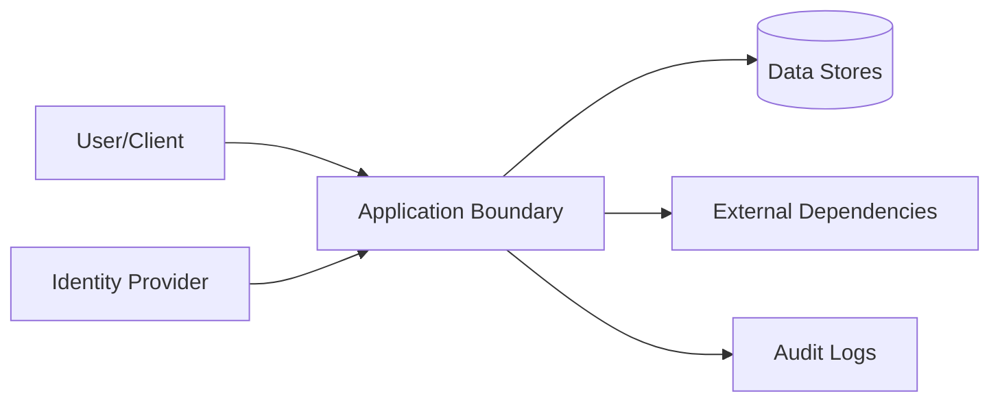

# Security

## Diagnostic read boundary

Snapshot inspection accepts only SELECT/WITH and rechecks native statement
read-only status. It rejects preparation-time PRAGMA and enforces scoped native
and result budgets. Callers own authorization, redaction and bounded callback
work. No raw handle, credential, automatic maintenance or remote fallback is
exposed.

## Cloud connector and managed-auth credentials

`src/cloud.rs` discovers only public profile metadata before sending credentials.
The selected HTTPS origin is trusted configuration; profile-origin mismatches,
redirects, secret/service-role keys and invalid schemas fail before native RPC
construction. Literal loopback HTTP exists only for disposable tests. Access
bearers accompany data calls and authenticated completion; refresh tokens and
PKCE verifiers are sent only to fixed managed Auth paths on that same origin.
Dactyl stores no durable sessions and does not open the browser. The caller owns
private pending-flow checkpoints and must not replay unknown one-time exchange
or rotation outcomes. Credential types redact Debug and auth errors omit remote
messages. Propodus-managed Auth/RLS/grants enforce identity and permissions;
caller context and local agent labels cannot elevate cloud authority.

Normal account and data access depend on the Supabase user session, paid-seat
assignment and backend tenant/project isolation. Optional explicit SCM linking
adds X-SCM-Token, X-SCM-Provider and X-SCM-Host only to the account channel, with
fixed GitHub/GitLab hosts; it never supplies ordinary data authority. Dactyl does
not infer this channel from a sign-in provider token. Redirects and automatic
retries are disabled for auth, discovery and account requests. Only allowlisted
public denial codes appear in errors; remote messages and credentials do not.

## Secure shared-directory SQLite recovery

Private staging and creation-time modes protect rebuilt data under permissive umasks. Activation restores existing permission bits only after validation. Source access ACLs, inherited default ACLs and MAC/system access labels fail closed rather than being silently replaced; unrelated user attributes and unchanged parent POSIX access ACLs are permitted. Original/archive metadata remains untouched. Callers must quiesce filesystem name/content/metadata writers from connection open; inode checks are detection boundaries, not protection against arbitrary malicious concurrent directory writers.

## Threat Model

## STRIDE Table
| Threat | Surface | Mitigation | Verification |
|---|---|---|---|
| Spoofing | Auth boundary | strong auth + token validation | auth tests |
| Tampering | State mutation APIs | integrity checks + RBAC | integration tests |
| Repudiation | Critical actions | immutable audit logs | log review |
| Information disclosure | Data at rest/in transit | encryption + classification | security scans |
| Denial of service | Hot paths | rate limit + backpressure | load tests |
| Elevation of privilege | Admin interfaces | least privilege + policy checks | authz tests |
| Tampering / confusion | Local store path | open through SQLite's file validation; do not convert or reinterpret unknown files; fail closed on malformed databases | `existing_sqlite_fixture_opens_without_conversion` and typed invalid-database mapping |
| Destructive recovery / partial replacement | Explicit SQLite maintenance API | No automatic repair; require an unused same-directory archive, validate and sync a new file before activation, preserve main/WAL/SHM originals, and attempt rollback on rename/sync/reopen failure | `sqlite_maintenance` recovery, archive-conflict, and reopen contract tests |
| Concurrent store access | SQLite maintenance and mounted filesystems | Live backup uses SQLite's online backup API; recovery requires same-process quiescence and cooperating writers; arbitrary external writers and unreliable advisory-lock propagation remain unsupported | WAL backup, open-connection, and bounded lock tests plus documented limitations |

## Authentication
- Identity source:
- Token/session lifetime:
- Rotation and revocation:

## Authorization
- Role model:
- Resource-level policy:
- Privilege escalation controls:

## Data Classification
| Data Class | Examples | Storage Rules | Access Rules |
|---|---|---|---|
| Public | docs, non-sensitive metadata | standard | unrestricted |
| Internal | operational telemetry | controlled | team access |
| Sensitive | tokens, PII, secrets | encrypted | least privilege |

## Sensitive Data Handling
- Encryption at rest:
- Encryption in transit:
- Redaction in logs:
- Retention + deletion policy:

## Supply Chain Security
- Recommended scanners: `cargo audit`, `cargo deny`, `cargo vet`
- Dependency update cadence:
- Signed artifact/provenance strategy:

## Secrets Management
| Secret | Source | Rotation | Consumer |
|---|---|---|---|
| External service auth material | managed runtime configuration | periodic | runtime services |
| Artifact signing material | managed signing service/local secure store | periodic | release pipeline |

## Security Testing
| Test Type | Cadence | Tooling |
|---|---|---|
| SAST | each PR | language linters/scanners |
| Dependency scan | each PR + weekly | supply-chain tools |
| DAST/pentest | scheduled | external/internal |

## Compliance and Audit
- Regulatory scope:
- Audit evidence location:
- Exception process:

## Pre-Promotion Security Checklist
- [ ] Threat model updated for changed surfaces.
- [ ] Auth/authz tests pass.
- [ ] Dependency vulnerability scan reviewed.
- [ ] No unresolved critical/high security findings.

## Strongest Security Primitives
Describe the security primitives and security controls implemented in this repository.

## Security Practices
- **Least Privilege**: Ensure minimal access permissions for all subsystems and roles.
- **Input Validation**: Strictly validate all inputs at trust boundaries.
- **Secure Storage**: Encrypt sensitive data at rest and in transit.

<!-- decapod:capability-overlay:public-api:start -->

Generated capability obligations: `public-api` is declared for this project. These are decisions and proof requirements, not claims of implemented behavior. Resolve each against project source and tests; record unsupported or non-applicable mechanisms explicitly.

## Public API Security Overlay

### Authentication Requirements
- All public endpoints MUST validate authentication tokens
- Token validation MUST include expiry, revocation, and scope checks
- Anonymous access MUST be explicitly documented and justified

### Input Validation
- All request bodies MUST be validated against schemas
- Reject requests with unknown fields (strict schema validation)
- Size limits MUST be enforced on all request bodies

### Rate Limiting
- Limits and enforcement boundaries MUST be selected for this deployment
- Clustered enforcement behavior MUST be documented when applicable
- Client-visible throttling behavior MUST be part of the contract when applicable
<!-- decapod:capability-overlay:public-api:end -->

<!-- decapod:codebase-attestation:start -->

## Codebase Attestation

- Repository signal fingerprint: `c1f0fa0d89e343aa84446142f2cf99b2351816fbf48ab7b7912942e538686216`
- Significant implementation surfaces: `.github/` (4 files), `Cargo.lock/` (1 files), `Cargo.toml/` (1 files), `README.md/` (1 files), `examples/` (1 files), `src/` (16 files), `tests/` (15 files), `tools/` (2 files)
- Refreshed from the current codebase by `decapod rpc --op specs.refresh`
<!-- decapod:codebase-attestation:end -->
