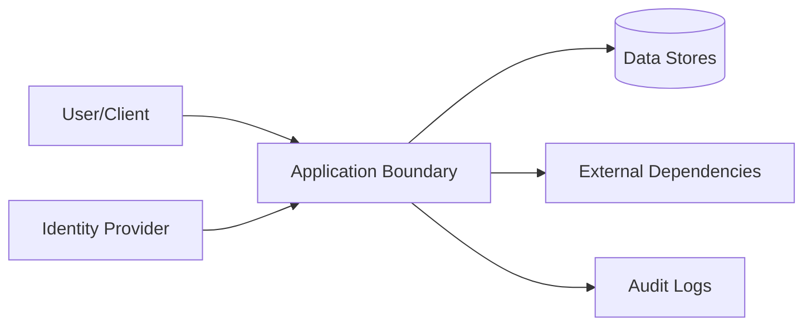

# Security

## Per-client TLS provider invariant (issue 100)

Every HTTPS adapter constructs its own ring provider and WebPKI trust store through `src/http_tls.rs`. The helper uses rustls safe default protocol versions, normal certificate and hostname verification, SNI and no client certificate. It neither installs nor reads a process-global crypto provider. An application's ambient provider cannot silently alter this connector's crypto policy, and Dactyl's client construction cannot change the application's provider. The repair does not add a custom verifier, insecure certificate option or HTTP/3 transport.

The isolated child-process regression must verify successful client construction with no ambient provider, absence of global installation as a side effect, and successful construction with an unrelated unusable ambient provider. It checks the configured TLS 1.2/1.3 cipher-suite policy and enabled SNI. Existing loopback transport fixtures remain required to catch a mismatched preconfigured TLS type. These checks establish configuration and client-construction behavior; they do not claim hosted TLS, managed Auth, account policy or deployment acceptance.

## Managed cloud credential and origin boundary (issue 100)

Cloud profile discovery is deliberately unauthenticated and database-independent; it never receives a user bearer, API key or cookie. Its fixed origin, version, schema and public-key validation precede credential transport. The browser handoff is restricted to that origin, fixed begin path and exactly the flow identifier plus a valid one-time ticket. Redirects and automatic HTTP retries are disabled. Credentials are ephemeral transport inputs, redact Debug, never enter `StorageContext`, and are persisted only by the caller. Authentication responses retain repository/expiry bindings so the caller can reject cross-repository or stale flow state. Dactyl never infers a role from email, SCM username or payment.

Auth/discovery requests have five-second connect and fifteen-second full-request deadlines and 16 KiB body limits. Joined workers leave no daemon. After a dispatched mutation, transport or response-validation failure reports `outcome_unknown`; the caller must resolve its private journal rather than blindly repeat a one-time exchange or rotation. Fixed service denial codes remain explicit, while raw messages, unknown codes, details, hints and transport URLs are redacted. These client checks do not prove hosted policy, PostgreSQL grants or managed Auth replay behavior.

## Secure shared-directory SQLite recovery

Private staging and creation-time modes protect rebuilt data under permissive umasks. Activation restores existing permission bits only after validation. Source access ACLs, inherited default ACLs and MAC/system access labels fail closed rather than being silently replaced; unrelated user attributes and unchanged parent POSIX access ACLs are permitted. Original/archive metadata remains untouched. Callers must quiesce filesystem name/content/metadata writers from connection open; inode checks are detection boundaries, not protection against arbitrary malicious concurrent directory writers.

## Threat Model

## STRIDE Table
| Threat | Surface | Mitigation | Verification |
|---|---|---|---|
| Spoofing | Auth boundary | strong auth + token validation | auth tests |
| Tampering | State mutation APIs | integrity checks + RBAC | integration tests |
| Repudiation | Critical actions | immutable audit logs | log review |
| Information disclosure | Data at rest/in transit | encryption + classification | security scans |
| Denial of service | Hot paths | rate limit + backpressure | load tests |
| Elevation of privilege | Admin interfaces | least privilege + policy checks | authz tests |
| Tampering / confusion | Local store path | open through SQLite's file validation; do not convert or reinterpret unknown files; fail closed on malformed databases | `existing_sqlite_fixture_opens_without_conversion` and typed invalid-database mapping |
| Destructive recovery / partial replacement | Explicit SQLite maintenance API | No automatic repair; require an unused same-directory archive, validate and sync a new file before activation, preserve main/WAL/SHM originals, and attempt rollback on rename/sync/reopen failure | `sqlite_maintenance` recovery, archive-conflict, and reopen contract tests |
| Concurrent store access | SQLite maintenance and mounted filesystems | Live backup uses SQLite's online backup API; recovery requires same-process quiescence and cooperating writers; arbitrary external writers and unreliable advisory-lock propagation remain unsupported | WAL backup, open-connection, and bounded lock tests plus documented limitations |

## Authentication
- Identity source:
- Token/session lifetime:
- Rotation and revocation:

## Authorization
- Role model:
- Resource-level policy:
- Privilege escalation controls:

## Data Classification
| Data Class | Examples | Storage Rules | Access Rules |
|---|---|---|---|
| Public | docs, non-sensitive metadata | standard | unrestricted |
| Internal | operational telemetry | controlled | team access |
| Sensitive | tokens, PII, secrets | encrypted | least privilege |

## Sensitive Data Handling
- Encryption at rest:
- Encryption in transit:
- Redaction in logs:
- Retention + deletion policy:

## Supply Chain Security
- Recommended scanners: `cargo audit`, `cargo deny`, `cargo vet`
- Dependency update cadence:
- Signed artifact/provenance strategy:

## Secrets Management
| Secret | Source | Rotation | Consumer |
|---|---|---|---|
| External service auth material | managed runtime configuration | periodic | runtime services |
| Artifact signing material | managed signing service/local secure store | periodic | release pipeline |

## Security Testing
| Test Type | Cadence | Tooling |
|---|---|---|
| SAST | each PR | language linters/scanners |
| Dependency scan | each PR + weekly | supply-chain tools |
| DAST/pentest | scheduled | external/internal |

## Compliance and Audit
- Regulatory scope:
- Audit evidence location:
- Exception process:

## Pre-Promotion Security Checklist
- [ ] Threat model updated for changed surfaces.
- [ ] Auth/authz tests pass.
- [ ] Dependency vulnerability scan reviewed.
- [ ] No unresolved critical/high security findings.

## Strongest Security Primitives
Describe the security primitives and security controls implemented in this repository.

## Security Practices
- **Least Privilege**: Ensure minimal access permissions for all subsystems and roles.
- **Input Validation**: Strictly validate all inputs at trust boundaries.
- **Secure Storage**: Encrypt sensitive data at rest and in transit.

<!-- decapod:capability-overlay:public-api:start -->

Generated capability obligations: `public-api` is declared for this project. These are decisions and proof requirements, not claims of implemented behavior. Resolve each against project source and tests; record unsupported or non-applicable mechanisms explicitly.

## Public API Security Overlay

### Authentication Requirements
- All public endpoints MUST validate authentication tokens
- Token validation MUST include expiry, revocation, and scope checks
- Anonymous access MUST be explicitly documented and justified

### Input Validation
- All request bodies MUST be validated against schemas
- Reject requests with unknown fields (strict schema validation)
- Size limits MUST be enforced on all request bodies

### Rate Limiting
- Limits and enforcement boundaries MUST be selected for this deployment
- Clustered enforcement behavior MUST be documented when applicable
- Client-visible throttling behavior MUST be part of the contract when applicable
<!-- decapod:capability-overlay:public-api:end -->

<!-- decapod:codebase-attestation:start -->

## Codebase Attestation

- Repository signal fingerprint: `3334a42e2f74c3515a5c4f561c76e5fe05a408b439473e2840f14f3a8a3679e7`
- Significant implementation surfaces: `.github/` (4 files), `Cargo.lock/` (1 files), `Cargo.toml/` (1 files), `README.md/` (1 files), `examples/` (1 files), `scripts/` (4 files), `src/` (15 files), `tests/` (14 files)
- Refreshed from the current codebase by `decapod rpc --op specs.refresh`
<!-- decapod:codebase-attestation:end -->
