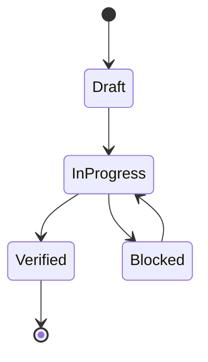

# Semantics

## Client knowledge and independent server outcomes (issue 85)

docs/cloud-failure-conformance.md defines the remaining native fault/concurrency proof matrix. LocalBudget/NotAttempted, known local rollback, conservative remote Uncertain outcomes and managed-auth/account outcome_unknown retain their existing src/error.rs and src/cloud.rs semantics. A transport failure cannot establish server rollback. Independent observers must distinguish actual commit, abort or unresolved state; callers retain reconciliation/idempotency policy and never automatically replay uncertain mutations. Synthetic tests and client-side read-only refusal do not establish real server enforcement, concurrent winners, effective grants or hosted proof capture. Decapod owns applicability; Propodus owns authenticated authority and physical state/event transactions.

## Resource-budget, scan, and mutation-outcome invariants (issue 101)

- Deliberate visitor stop (`Ok(false)` in `Connection::visit_rows`) returns `Ok(ScanOutcome { rows, complete: false })` and releases native SQLite statement locks before returning; budget exhaustion (`max_columns`, `max_rows`, `max_cell_bytes`, `max_result_bytes`, `max_wire_bytes`) always returns `Err(DactylError)`, never silent partial truncation.
- Local SQLite `atomic` batches share one `DecodedResultTracker` across operations; if a trailing read exceeds `ResourceBudget`, SQLite rolls back prior writes in the batch and classifies the error as `FailureOrigin::LocalBudget` with `MutationOutcome::RolledBack`.
- Remote `write` and mutating `atomic` requests classify preflight/capability rejections as `MutationOutcome::NotAttempted`, explicit pre-commit remote policy/constraint denials as `MutationOutcome::RolledBack`, and post-send transport/timeout/`408`/`502`/`504`/oversized/malformed/post-response decode failures as `MutationOutcome::Uncertain`. A retryable error category never implies replay safety for `Uncertain` mutations without caller or service idempotency.

## State Machines

## Invariants
| Invariant | Type | Validation |
|---|---|---|
| No promoted change without proof | System | validation gate |
| Canonical source-of-truth per entity | Data | interface/spec review |
| Mutation events are replayable | Data | deterministic replay |

## Event Sourcing Schema
| Field | Type | Description |
|---|---|---|
| event_id | string | globally unique event id |
| aggregate_id | string | entity/workflow id |
| event_type | string | semantic transition |
| payload | object | transition data |
| recorded_at | timestamp | append time |

## Replay Semantics
- Replay order:
- Conflict resolution:
- Snapshot cadence:
- Determinism proof strategy:

## Error Code Semantics
- Namespace:
- Stable compatibility window:
- Mapping to retry/degrade behavior:

## Domain Rules
- Local conditional writes report stale CAS as `affected_rows = 0`. Dactyl does not promote a local zero-row update into `VersionConflict`; that code is a remote/provider outcome.
- Local storage ignores `StorageContext`. Cloud-only tenancy fields are not required, stored, or interpreted. The same local SQL has the same result with or without a context envelope.
- Concurrent local writers serialize on the route lock file. Cleanup is a caller-owned `DROP TABLE` / `DROP INDEX`; Dactyl does not retain scoped test schemas.
- A local route is a real SQLite database. Read/write opens may create the requested file; read-only opens require it to exist. SQLite owns file-format compatibility, locking, journaling, and recovery. Dactyl configures foreign-key enforcement and the caller's busy timeout.
- Atomic local batches begin one SQLite transaction and roll back the entire batch on any operation failure. Dactyl does not import, convert, snapshot, or rewrite local database files.
- Per-workspace `LogicalConnector` resolution binds either a local SQLite target or a cloud Supabase origin without global state or ambient environment variables; cloud discovery/capability errors fail closed without SQLite fallback, and post-send failures on one-time auth exchanges, token rotations, revocations, or mutating account operations (`Register`, `Checkout`, `Manage`) carry `outcome_unknown` rather than replaying automatically.

## Idempotency Contracts
| Operation | Idempotency Key | Duplicate Behavior |
|---|---|---|
| create/update mutation | request_id | return original result |
| async enqueue | event_id | ignore duplicate enqueue |

## Language Note
- Primary language inferred: Rust

<!-- decapod:capability-overlay:background-processing:start -->

Generated capability obligations: `background-processing` is declared for this project. These are decisions and proof requirements, not claims of implemented behavior. Resolve each against project source and tests; record unsupported or non-applicable mechanisms explicitly.

## Background Processing Semantics Overlay

### Retry Semantics
- Retry and backoff behavior MUST be selected and documented for each work class
- Poison-work handling MUST be selected and documented for each work class
- Retry MUST preserve the declared side-effect and idempotency semantics

### Idempotency
- Each job MUST declare whether it is idempotent, transactional, compensating, or otherwise duplicate-safe
- Deduplication or compensation mechanisms are project decisions and require proof
- Duplicate execution MUST follow the job's declared duplicate-handling semantics

### Poison Message Handling
- Document the actual terminal-failure behavior for exhausted or non-retryable work; a dead-letter queue is not implied
- If a dead-letter queue exists, document its monitoring, alerting, and ownership
- If manual replay is supported, document authorization and duplicate-side-effect proof; otherwise record the limitation
<!-- decapod:capability-overlay:background-processing:end -->

<!-- decapod:capability-overlay:persistent-state:start -->

Generated capability obligations: `persistent-state` is declared for this project. These are decisions and proof requirements, not claims of implemented behavior. Resolve each against project source and tests; record unsupported or non-applicable mechanisms explicitly.

## Persistent State Semantics Overlay

### Transaction Semantics
- Atomicity boundaries and any non-atomic operations MUST be declared with source and test evidence
- Document observed read-after-write behavior; do not infer consistency from a capability declaration
- Eventual consistency windows MUST be documented

### Migration Semantics
- Migration compatibility, any breaking changes, and their recovery path MUST be explicit and tested
- Migration rollback procedures MUST be documented
- Data integrity checks post-migration

### Recovery Semantics
- Document supported recovery mechanisms and evidence; point-in-time recovery is not implied by persistent-state
- Recovery objectives MUST be selected for the project and recorded as proof obligations
- Recovery test cadence MUST be selected for the project and recorded as a proof obligation
<!-- decapod:capability-overlay:persistent-state:end -->

<!-- decapod:codebase-attestation:start -->

## Codebase Attestation

- Repository signal fingerprint: `8c96db42fef0720bb66930d70e42f7a03327f2fe80c061ff57ddf1ee8fa71da7`
- Significant implementation surfaces: `.github/` (4 files), `Cargo.lock/` (1 files), `Cargo.toml/` (1 files), `README.md/` (1 files), `examples/` (1 files), `src/` (18 files), `tests/` (23 files), `tools/` (2 files)
- Refreshed from the current codebase by `decapod rpc --op specs.refresh`
<!-- decapod:codebase-attestation:end -->
